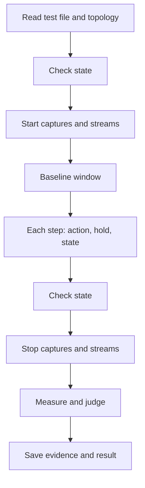

# Lab tests with Networka

This is a design proposal. The prototype in `labtest.py` builds the part described in the user guide [lab tests](../lab-tests.md). The decisions it made are listed under Decisions. The rest is not built yet, apart from the parts marked as existing.

## Problem

Each lab repository contains its own test program. The MikroTik MLAG suite has about 7,400 lines of Python for it. The ot-lab and the BLT lab have their own scripts for the same jobs. Each of them reaches lab nodes with `docker exec` or `nsenter`, starts `tcpdump` and ping loops, reads RouterOS state and judges the result. Only the MLAG suite measures how long traffic stopped. The BLT lab polls once per second, and the ot-lab only detects complete loss.

A new lab, for example a Cumulus lab, has to copy or rewrite such a program before its first test runs.

## Goal

A lab repository describes its lab and its tests, and Networka runs them.

The lab repository holds the containerlab topology, the device configs and the test files in YAML. It holds no test logic. Networka holds the engine. The engine reaches the nodes, checks device state, starts streams and captures, applies the fault, measures the outage, judges it against the limits in the test file, saves the evidence and replays it.

The engine works for RouterOS, Cumulus and Linux nodes. The state checks are vendor-neutral, and the traffic measurement does not depend on the vendor.

## Scope

In a production network Networka runs the checks that need one command and its reply. These are the state checks, `ping` and the path checks that read device state.

In a containerlab lab Networka also runs traffic tests with streams and captures. It can do this because every node's network namespace is reachable on the lab host.

The lab part supports containerlab only.

## What a tester can check

| Check | Question it answers | Production | containerlab | Status |
|---|---|---|---|---|
| State checks such as `mlag`, `stp_bridge`, `bridge_port`, `lacp_member`, `bond_members`, `host_entry`, `interface_up`, `property` | Is the device in the expected state | yes | yes | exists |
| `ping` | Can this node reach that address | yes | yes | exists |
| `route_lookup` | Which interface and next hop does the device use for a destination | yes | yes | planned |
| `lldp_neighbor` | Is this port connected to the expected device and port | yes | yes | planned |
| `traceroute` | Which routed hops does a packet pass | yes | yes | planned |
| Comparison between devices | Do two devices report the same value, or different values | yes | yes | planned |
| Outage per stream and step | How long did a stream stop after an action | no | yes | planned |
| Duplicates and floods | Did a frame arrive twice or come back to its sender | no | yes | planned |
| Observed path | At which capture points was a stream seen | no | yes | planned |
| Packet filter at a capture point | Was a packet matching a filter seen there | no | yes | later |

## Path checks

A probe such as traceroute shows the routed hops between two addresses. It cannot show which member of a bond or which MLAG peer carried a frame, because those are layer 2 choices. Tools such as mtr and trippy have the same limit and need an extra install.

Networka checks the path in these ways.

- `route_lookup` asks a device which interface and next hop it uses for a destination. Linux and Cumulus answer with `ip -j route get`. RouterOS answers with `/ip/route/check`. No packet is sent.
- `lldp_neighbor` checks that a port is connected to the expected device and port.
- `host_entry` checks on which port a switch has learned a MAC address. This check exists today.
- `traceroute` lists the routed hops, for networks where routing decides the path.
- In a containerlab lab, a traffic test records at which capture points each numbered packet was seen. The expectations `seen_at` and `not_seen_at` check this. It also works on layer 2.

## The test file

One test file describes one test. This example is the MLAG case "bond member loss and return".

```yaml
name: MLAG bond member loss and return
state:
  - state/small.yaml

streams:
  - id: 101
    from: c1:bond0
    to: mobile:bond0
  - id: 201
    from: mobile:bond0
    to: c1:bond0
  - id: 301
    from: c1:eth3
    to: c2:eth3

captures:
  - c1:eth1

steps:
  - name: Member down
    action:
      link: c1:eth1
      state: down
    hold_s: 8
    expect:
      - streams: [101, 201]
        max_outage_s: 3
      - streams: [301]
        max_outage_s: 0
      - streams: [101]
        not_seen_at: [c1:eth1]
  - name: Member back
    action:
      link: c1:eth1
      state: up
    hold_s: 10
    expect:
      - streams: [101, 201]
        max_outage_s: 3
      - streams: [301]
        max_outage_s: 0
```

| Field | Meaning |
|---|---|
| `name` | Title shown in the result. |
| `state` | State files. A state file is a list of statements. Each statement is one sentence with an optional source and the intent checks that prove it. The engine checks them before the first step and after the last step. |
| `streams` | Numbered ping streams. `id` becomes the ICMP identifier. `from` and `to` are capture points written as `node:interface`. The destination is the IPv4 address of `to`, unless `address` is given. One ping is sent every 100 ms. |
| `captures` | Extra capture points. The endpoints of every stream are always captured. |
| `steps` | Ordered list. A step has a `name`, an optional `action`, a hold time `hold_s` and a list of `expect` entries. A step without an action is an observation window. A baseline test is one such step. |
| `until` | Optional in a step. State checks that must pass before the hold time starts, with a `timeout_s`. A step uses it after a reboot. |
| `expect` | `max_outage_s` sets the longest allowed outage for the listed streams in this step. `seen_at` and `not_seen_at` name capture points where the listed streams must or must not appear. |

A stream with `flood: true` sends to a broadcast address, or to an address that no node owns. Each capture point in its `receivers` list must see every frame once. The sender's own capture points must see no copy coming back.

The engine checks the following in every traffic test, without an entry in the file.

- Before the first action, the state checks pass and all streams run without loss for a baseline window.
- No reply arrives twice.
- Every capture ran without dropped packets, every stream was sent at its interval, and all capture and stream processes stayed up.

## How a test runs



The engine applies no action when the state checks before the first step do not pass, or when the baseline window shows loss. The result then says why.

Each step's window starts with its action and ends when the next step starts. An outage counts for the step in which it begins.

## How Networka reaches the lab

Networka reads the lab directory that containerlab writes. It contains the nodes, their kinds and the links with their endpoints.

Every node is reached over SSH, as in a production network. A Linux lab node therefore needs an SSH server and a login. The image of the lab provides both. Networka has one way to connect, and a check behaves the same in the lab and in production.

Streams and captures run as processes on the lab host, inside the network namespace of the node. This is the method that containerlab documents for captures. A capture point is a link endpoint from the topology, written as `node:interface`. All timestamps come from the clock of the lab host.

Traffic tests need root on the lab host, because entering a namespace and capturing packets need it.

## Actions

| Action | What the engine does |
|---|---|
| `{link: node:interface, state: down}` or `up` | Sets the carrier of that link at both ends. For a Linux container end it uses `ip link`. For a node that runs in QEMU it uses the QEMU monitor of that node, because the guest only sees a carrier change that way. |
| `{device: name, command: "..."}` | Runs one command on a node through Networka, for example a reboot. |
| `{local: "..."}` | Runs one command on the lab host from the lab repository. It covers a fault that only this lab needs. |

Link impairment with `containerlab tools netem` and power off for a node can follow when a second lab needs them.

## Evidence, verdict and replay

A test has the verdict `pass`, `fail` or `error`, as the state checks have today. `error` means the engine could not verify the result. The exit codes are 0, 1 and 2.

```text
out/01-bond-member-loss/
  test.yaml        the test file as it ran
  state-before/    intent.yaml, evidence.json, results.json
  state-after/
  captures/        one pcap per capture point, with pcap.sha256
  streams/         one ping log per stream
  events.jsonl     every action with its time
  result.json      the verdict and each expectation with expected and measured value
  timeline.tsv
```

```bash
sudo nw test run tests/small/*.yaml --save out/
nw test replay out/01-bond-member-loss
```

`nw test replay` computes `result.json` again from the saved files. It needs no lab.

## What a lab repository contains

```text
labs/small/small.clab.yml      topology and device configs
tests/small/state/*.yaml       state checks as intent files
tests/small/*.yaml             test files
hooks/                         local commands for faults that only this lab needs
docs/, results/                write-ups of the findings
```

## Decisions

| Decision | Alternative considered | Reason |
|---|---|---|
| The engine is in Networka and the test files are in the lab repository. | pytest fixtures in Networka and test code in each lab, as NUTS does. | Each lab would still write its own sequence and judging in Python. netlab and ANTA keep the engine in the tool and the tests as data. |
| A Linux lab node is reached over SSH. | `docker exec` into the node's container. | Networka keeps one way to connect, the same as in production. A second way would need its own rules for credentials, errors and timeouts. The lab image carries the SSH server. |
| The lab part supports containerlab only. | A layer that hides several lab technologies. | Every lab in use is a containerlab lab. containerlab already provides the topology file, the node namespaces and the link endpoints. |
| A test is an ordered list of steps with one fixed flow. | A YAML language with loops, conditions and parallel actions, as pyATS Blitz has. | Every one of the 88 cases with phases in the MLAG catalogue has one or two phases. A language adds a large surface that no case needs. An unusual test can be a short Python script that calls the engine's functions. |
| Streams and captures run as processes on the lab host in the node's namespace. | Long-running jobs over SSH. | The MLAG suite uses this method, and 20 live attempts on its five runners replayed with identical results. A Networka SSH session runs one blocking command and reports no exit status on Linux. |
| A stream is a numbered ping from the standard `ping` program. | A traffic generator such as TRex or ixia-c, or a packet sender written for the engine. | `ping` exists on every Linux node and needs no install. The interval sets the resolution of the result, so the result states the interval, as RFC 6413 asks. SONiC's test suite shows that a custom sender needs care with timing and threads. |
| The outage of a stream is measured from the captured packets at both ends of the stream, as a lower and an upper bound. | Counting lost pings only. | The captures show whether the request or the reply was lost, and where. This is the timestamp method of RFC 6201. |
| Captures are decoded with `tshark`. | A packet parser inside Networka. | The measuring code that moves from the MLAG suite is proven with `tshark`. Only traffic tests need it. |
| An action is a link change, a device command or a local command. | A library with one action per fault. | The faults in the MLAG catalogue are carrier cuts, LACPDU drops, a MAC move, a silent host, repeated member flaps, reboots, power loss, a stopped guest and an ICMP cut for calibration. Link changes and device commands cover most of them. The local command covers the rest without growing the engine. |
| No action runs unless the state checks pass and the streams run without loss first. | Run the action in any case. | A fault applied to a lab that is already broken gives a result that nobody can interpret. The MLAG suite has this rule. |
| Missing or invalid evidence gives `error` and never `pass`. | Count it as pass, or skip it. | The state checks follow the same rule. |
| Every run saves its test file and its evidence, and replay computes the result again. | Keep only the verdict. | A result can be checked later without the lab. The state checks follow the same rule. |
| A state file is a list of statements, and each statement names the intent checks that prove it. | Plain intent files. | A reader sees the claim and its source next to the checks. The result reports a verdict per statement. |
| Test files and state files are written in block style YAML with one field per line. | One-line mappings in braces. | Block style is easier to read and to review in a diff. |
| The endpoints of every stream are always captured, and `captures` only adds points. | `captures: all` for every link endpoint. | The measurement needs both ends of each stream. Extra points cost disk space and are added only where a reader needs them. |
| A limit of 0 fails on any lost probe. | Treat a lower bound of 0 as within a limit of 0. | A lost probe makes the outage longer than its lower bound. |

## Left out on purpose

- A traffic generator.
- Limits for latency and jitter.
- Loops, conditions and parallel actions in the test file.
- Deploying and destroying a lab. containerlab does this.
- Streams and captures in a production network. They would need long-running jobs over SSH.
- Reports over many runs. They stay in the lab repository.

## Code layout

```text
src/network_toolkit/
  intent.py                      state checks, intent files, run and replay (exists)
  platforms/<vendor>/intent.py   collectors and normalizers per vendor (exists)
  lab.py                         containerlab topology, streams, captures, link actions
  traffic.py                     decode captures, match streams, outage per step,
                                 duplicates, floods, observed path
  labtest.py                     test file format, the flow, judging, evidence, replay
  commands/test.py               nw test run and nw test replay
```

## Build order

Each step ends with a proof on real evidence before the next one starts.

1. **Linux lab nodes over SSH.** The Linux image of the lab gets an SSH server and a login. Networka needs no new way to connect. The proof is `nw intent run` with state checks on the CHR nodes and on a Linux client of the Small MLAG lab, and a `ping` from that client.
2. **Traffic tests.** Streams, captures, steps, expectations, evidence and replay. The generic measuring code of the MLAG suite, about 1,000 lines, moves into Networka. The first proof is offline. The engine must compute the same outage per stream and phase as the suite from the saved captures of the 20 live attempts. The second proof is live. The bond member loss case runs from a test file on a fresh Small lab, and its replay gives the same result.
3. **Path checks and the comparison between devices.** The proof is a live read on a CHR and on a Linux node.
4. **The MLAG cases become test files, one runner at a time.** The suite's Python for a runner is deleted when its cases give the same verdicts from saved captures and in one live run. The Cumulus lab gets its first test files when the Cumulus platform module exists.

## Open points

- A capture at the containerlab endpoint of a QEMU node may differ from a capture at the node's tap interface, which the MLAG suite uses today. A live comparison settles this.
- The way a step waits for a rebooted node is not decided. The MLAG suite waits until the uptime has reset.
- Namespace access needs root, and SSH needs the operator's credentials. The command has to handle both.
- A test may need state samples during a step. The MLAG suite samples every 0.35 s for its timeline.
- A flood stream to an unknown unicast address needs a fixed neighbour entry on the sender. The MLAG suite sets one.
- The link and power actions for the Cumulus node kind are not checked.
- The comparison of the 88 MLAG cases covers their shape, meaning phases, limits and streams. Each case still has to be mapped one by one.

## Sources

- netlab validation tests: <https://netlab.tools/topology/validate/>
- containerlab packet capture: <https://containerlab.dev/manual/wireshark/>
- containerlab link impairment: <https://containerlab.dev/cmd/tools/netem/set/>
- containerlab inventory files: <https://containerlab.dev/manual/inventory/>
- pyATS traffic loss check: <https://pubhub.devnetcloud.com/media/genie-trafficgen/docs/ixianative.html>
- SONiC test suite, advanced reboot test: <https://github.com/sonic-net/sonic-mgmt>
- RFC 6201, device reset characterization: <https://www.rfc-editor.org/rfc/rfc6201.html>
- RFC 6413, convergence benchmarking: <https://www.rfc-editor.org/rfc/rfc6413.html>
- ANTA connectivity tests: <https://anta.arista.com/stable/api/tests/connectivity/>
