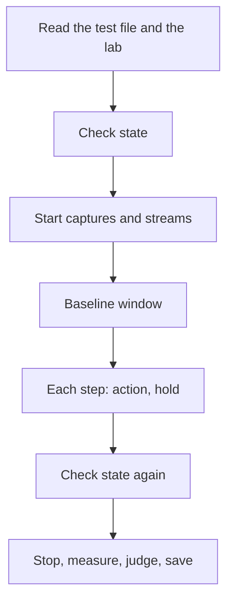

# Lab tests

A lab test applies a fault in a containerlab lab and measures how long traffic stopped. Networka checks the device state before and after, sends numbered ping streams, captures packets at both ends of each stream and judges each step against the limits in the test file. Every run saves its evidence, and `nw test replay` computes the same result again without the lab.

The lab repository holds the topology, the test files and the state files. Networka holds the engine.

## What it needs

- A deployed containerlab lab and its lab directory, the `clab-<name>/` folder that containerlab writes.
- Root on the lab host, next to containerlab. Entering a node's network namespace and capturing packets need root.
- `tcpdump`, `tshark`, `ping` and `nsenter` on the lab host.
- A Networka inventory that reaches every device of the state files over SSH, Linux lab nodes included.

Streams and captures run as processes on the lab host inside the network namespace of a node. All times come from the clock of the lab host.

## Capture points

A capture point is written `node:interface`. `node` is the containerlab node name. `interface` is the interface name inside the network namespace of that node's container, for example `dc1-traffic-host1:bond0`. A node that runs in QEMU, such as a MikroTik CHR, has a tap interface per NIC in its container, for example `dc1-core-mlag1:tap2`.

## Test file

A test file describes one test.

| Field | Required | Meaning |
| --- | --- | --- |
| `name` | Yes | Title shown in the result. |
| `source` | No | A URL or text that the test is based on. |
| `state` | Yes | State files, relative to the test file. Networka checks them before the first step and after the last step. |
| `streams` | Yes | Numbered ping streams. |
| `captures` | No | Extra capture points. The endpoints of every stream are always captured. |
| `steps` | Yes | Ordered steps. |

A stream has these fields.

| Field | Required | Meaning |
| --- | --- | --- |
| `id` | Yes | A number from 1 to 65535. It becomes the ICMP identifier of the pings. |
| `from` | Yes | The capture point that sends. It sees the requests leave and the replies return. |
| `to` | Yes | The capture point that answers. |
| `address` | No | The IPv4 address to ping. Without it, Networka pings the first IPv4 address of `to`. |

Each stream sends one ping every 100 ms.

A step has these fields.

| Field | Required | Meaning |
| --- | --- | --- |
| `name` | Yes | Name of the step. Each step needs its own name, and `baseline` is taken. |
| `action` | No | `link` names one end of a link, and `state` is `down` or `up`. A step without an action only observes. |
| `hold_s` | Yes | Seconds to wait after the action. |
| `expect` | Yes | Entries with `streams`, a list of stream IDs, and `max_outage_s`, the longest allowed outage of each listed stream in this step. |

A link action sets the carrier at both ends of the link. A Linux end changes with `ip link`. An end on a node that runs in QEMU also changes through the QEMU monitor, because only then does the guest see the carrier change. Networka confirms the carrier at both ends within 2 s before the hold starts.

Loading checks every field. An unknown field, a missing field, a stream ID in `expect` that is not in `streams` or a malformed capture point gives one error that names the file and the field.

## State file

A state file is a list of statements.

| Field | Required | Meaning |
| --- | --- | --- |
| `statement` | Yes | One sentence that the checks prove. |
| `source` | No | A URL or text that the statement comes from. |
| `checks` | Yes | Intent items in the format of [intent verification](intent.md): `device`, `check`, `params`, `expected` and an optional `name`. |

Networka runs all checks of all state files in one intent run and groups the results per statement. A statement passes when all its checks pass. It fails when one check fails. It is `error` when one check is `error` and none fails.

## How a test runs



1. Networka checks the state. If it does not pass, Networka applies no action.
2. Networka starts the captures and the streams and waits 2 s for neighbour discovery.
3. The baseline window lasts 5 s. Each stream needs 30 replies with no unanswered probe and no duplicate. Otherwise Networka applies no action.
4. Each step runs its action and waits `hold_s`.
5. After 2 s for late replies, Networka checks the state again and stops every process. A link that a step set down is set up again, also after an error or Ctrl-C.
6. Networka measures the streams from the captures, judges the steps and saves the result.

Each step's window starts with its action and ends when the next step starts. The last step ends after its hold. An outage counts for the step in which its first lost probe was sent.

## Verdict

A probe is delivered when its request and its reply appear at both capture points of the stream and the reply leaves within 0.5 s. A run of probes that were not delivered is an outage with a lower and an upper bound. The lower bound is the time from the first to the last lost request. The upper bound is the time from the last delivered request before the outage to the first delivered request after it.

Each listed stream in each step gets a verdict.

- `pass` when the upper bound is at most `max_outage_s`.
- `fail` when the lower bound is above `max_outage_s`. A lost probe makes the outage longer than its lower bound, so a lower bound equal to the limit also fails. A limit of 0 therefore fails on any lost probe.
- `error` when the bounds straddle the limit.
- `fail` when a probe arrived twice.

These validity checks give `error` and never `pass`.

- A capture is missing, changed since the run, or the kernel dropped packets.
- A capture or stream process ended early.
- A link could not be set up again.
- The wall clock and the monotonic clock of the lab host differ by 50 ms or more.
- A stream paused for more than 450 ms between two sends.
- The two capture points of a stream saw different replies.
- The baseline window in the captures has fewer than 30 delivered probes per stream, a lost probe or a duplicate.

The test verdict is `fail` if anything fails, else `error` if anything is `error`, else `pass`. The exit status is 0, 1 or 2.

## Example

This test cuts client 1's cable to the first MLAG peer for 8 s. It comes from the MikroTik MLAG test suite.

```yaml
name: MLAG bond member loss and return
source: https://manual.mikrotik.com/docs/high-availability-solutions/multi-chassis-link-aggregation-group/
state:
  - state.yaml
streams:
  - id: 101
    from: dc1-traffic-host1:bond0
    to: dc1-mac-move-host:bond0
    address: 10.110.0.50
  - id: 301
    from: dc1-traffic-host1:eth3
    to: dc1-traffic-host2:eth3
    address: 198.51.100.2
captures:
  - dc1-core-mlag1:tap2
steps:
  - name: Member down
    action:
      link: dc1-traffic-host1:eth1
      state: down
    hold_s: 8
    expect:
      - streams: [101]
        max_outage_s: 3
      - streams: [301]
        max_outage_s: 0
  - name: Member back
    action:
      link: dc1-traffic-host1:eth1
      state: up
    hold_s: 11
    expect:
      - streams: [101]
        max_outage_s: 3
      - streams: [301]
        max_outage_s: 0
```

`state.yaml` next to it holds the statements.

```yaml
- statement: Both MLAG peers show mlag-state connected.
  source: https://manual.mikrotik.com/docs/high-availability-solutions/multi-chassis-link-aggregation-group/
  checks:
    - name: mlag1 MLAG connected
      device: dc1-core-mlag1
      check: mlag
      params:
        bridge: bridge
      expected:
        connected: true
    - name: mlag2 MLAG connected
      device: dc1-core-mlag2
      check: mlag
      params:
        bridge: bridge
      expected:
        connected: true
```

Run it as root on the lab host.

```bash
sudo nw test run tests/small/bond-member-loss.yaml \
  --lab /path/to/clab-mlag-small --save out --config labs/networka/small.yml
```

`nw test run` takes several test files and runs them in order. It also takes `--interactive-auth`, as `nw intent run` does. The output lists each statement with its verdict, each step with each stream's outage, limit and verdict, and the test verdict.

## Evidence

Each test gets one folder under `--save`, named after the test file. The folder must not hold evidence yet.

```text
out/bond-member-loss/
  test.yaml        the test file as it ran
  state/           the state files as they ran
  state-before/    intent.yaml, evidence.json and results.json of the first state check
  state-after/     the same for the second state check
  captures/        one pcap and tcpdump log per capture point, and pcap.sha256
  streams/         one ping log per stream
  events.jsonl     every action with its epoch and monotonic time
  result.json      the verdict with every statement, step and validity check
  timeline.tsv     the events and the outages in time order
```

`result.json` lists each statement with its checks, expected and observed values. It lists each step with each stream's outage bounds, lost probes, limit and verdict. It also lists the validity checks, the baseline and the full measurement of every stream.

## Replay

```bash
nw test replay out/bond-member-loss
```

Replay computes `result.json` again from the saved files only. It needs `tshark` and no lab. It prints the same tables as the run. It exits 2 when the computed result differs from the saved `result.json`.

## Limits of this version

- The only action is a link down or up.
- A step cannot wait for a state, such as a rebooted node.
- Streams are unicast pings. Floods, duplicates per capture point and the observed path are not checked yet.
