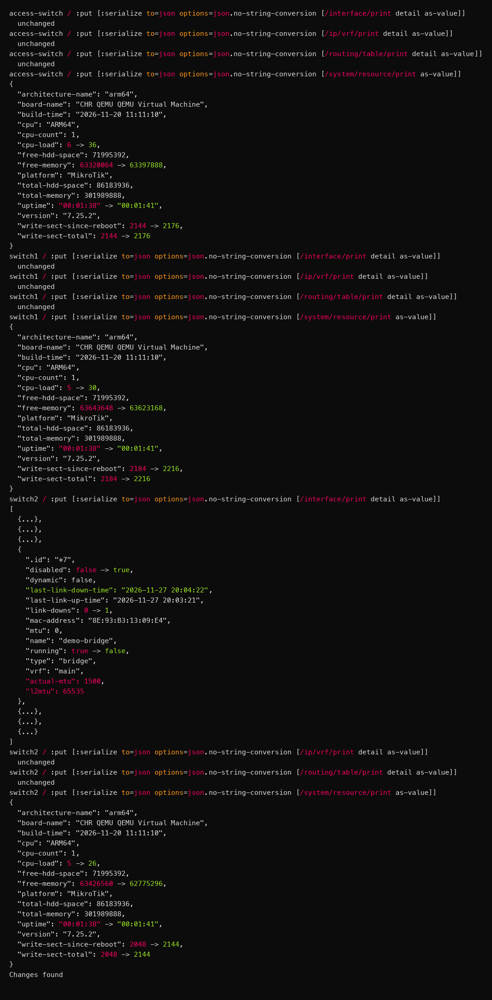

# Compare RouterOS state around an upgrade

Collect every RouterOS switch in a lab or customer upgrade group with one
`nw run` invocation. Define the queries once as a Networka sequence, collect
the whole group before and after your upgrade, then compare both saved bundles
with one `nw diff` invocation.

## Define the group once

Use your existing Networka inventory and SSH credentials. Merge these settings
into its configuration, keeping the existing device and credential entries:

```yaml
general:
  results_format: json

groups:
  lab_switches:
    description: All RouterOS switches in the lab
    members: [switch1, switch2, access-switch]
```

Replace the member names with every RouterOS device in your upgrade scope, or
use an existing group that covers them. Confirm every member is present in the
inventory. This example includes all three switches of a lab.

## Define the collection once

Save [upgrade-state.yml](examples/upgrade-state.yml) in a `sequences/` directory
beside your main configuration file. For example, with `./devices.yml` as the
configuration, use `./sequences/upgrade-state.yml`:

```yaml
sequences:
  upgrade_state:
    description: Native RouterOS JSON for an upgrade comparison
    device_types: [mikrotik_routeros]
    commands:
      - ':put [:serialize to=json options=json.no-string-conversion [/interface/print detail as-value]]'
      - ':put [:serialize to=json options=json.no-string-conversion [/ip/vrf/print detail as-value]]'
      - ':put [:serialize to=json options=json.no-string-conversion [/routing/table/print detail as-value]]'
      - ':put [:serialize to=json options=json.no-string-conversion [/system/resource/print as-value]]'
```

Edit this list to choose what the customer needs collected. Every command must
return native JSON; these four were exercised on RouterOS 7.24.5 and 7.25.2.
Keep the command list, device names and group membership the same across each
before/after comparison.

## Collect before the upgrade

Run from your Networka checkout. Set your group and configuration path, and
keep this terminal open:

```bash
uv sync --locked

TARGET="lab_switches"
CONFIG="./devices.yml"
mkdir -p ./captures
SAVE=$(mktemp -d ./captures/upgrade.XXXXXX)
printf 'Save directory: %s\n' "$SAVE"

uv run --locked nw run "$TARGET" upgrade_state \
  --config "$CONFIG" --store-results --results-dir "$SAVE/before"
```

This single invocation collects all four queries on every group member.
Confirm exit `0` and a summary showing every expected device succeeded, with
zero failures. For this three-switch group:

```text
Devices: 3 total | 3 succeeded, 0 failed
```

Networka creates a timestamped directory under `$SAVE/before`, containing a
directory for each device and a group summary. This example saves twelve JSON
replies, three sequence summaries and one group summary. Each reply keeps the
device, exact command, collection time and native JSON output.

## Perform your upgrade and collect again

Use your approved upgrade procedure. Once SSH access returns on every group
member, collect the same sequence for the whole group with a new destination:

```bash
uv run --locked nw run "$TARGET" upgrade_state \
  --config "$CONFIG" --store-results --results-dir "$SAVE/after"
```

Confirm exit `0`, the same expected device count and zero failures. The
timestamped directory under `$SAVE/after` has the same per-device layout.
Run each capture once in these directories. If you collect again, select the
exact timestamped directories printed by Networka for the comparison; keep
the original capture files.

## Compare the complete bundles

```bash
uv run --locked nw diff "$SAVE/before" "$SAVE/after" --structured
```

One comparison covers every device and command in both bundles: twelve
device/query pairs for this three-switch group. Its output labels each device
and exact command. Missing, failed or incomplete saved collections produce an
error. All device fields remain included. Objects are compared by their fields;
array order is preserved, so row reordering also appears as a difference.

A color terminal shows DeepDiff's compact colored view. Exit `0` means no
differences, `1` means differences found, and `2` means an error or unusable
saved results. Review the differences before accepting the upgrade.

## Review the changes

| Field or state | Expected or required review |
|---|---|
| Software version and build time | Expected to change; confirm the planned target release. |
| Uptime, last-link-up times and counters | Can reset or change across the reboot and collection interval. |
| CPU load, free memory and free storage | Can change; investigate unexpectedly constrained resources. |
| Interface running/disabled state, MTU and VRF assignment | Expect preservation unless planned. Investigate an in-service interface that becomes down or disabled. |
| MAC addresses | Review changes explicitly; physical-interface MAC addresses should remain the same. |
| VRFs and routing-table definitions | Expect preservation unless planned; investigate missing or unexpectedly changed entries. |

Keep both saved bundles with the change record. These four queries cover
interfaces, VRFs, routing-table definitions and resources; apply the customer's
traffic and protocol acceptance checks separately.

## Inspect the verified lab result

On 27 November 2026, the published YAML and shell blocks above were exercised
unchanged in one shell on a connected three-switch containerlab lab. Networka
was commit [a74942c](https://github.com/narrowin/networka/commit/a74942c2319aa1acf47ef111240d46e56f0b9343),
and all three switches ran RouterOS 7.25.2 throughout. The controlled change
between collections disabled only the spare `demo-bridge` on `switch2`.

Both collections returned exit `0` and reported `3 succeeded, 0 failed`.
Each bundle contained twelve JSON replies, three sequence summaries and one
group summary. The single `nw diff` compared all twelve device/query pairs
and returned exit `1`, meaning differences found.

| Device | Interfaces | VRFs | Routing-table definitions | Resources |
|---|---|---|---|---|
| switch1 | Unchanged | Unchanged | Unchanged | Changed |
| switch2 | Spare bridge disabled | Unchanged | Unchanged | Changed |
| access-switch | Unchanged | Unchanged | Unchanged | Changed |

The changed bridge had `disabled: false -> true`, `running: true -> false`
and `link-downs: 0 -> 1`. RouterOS added its last-link-down time and stopped
returning its operational MTU fields. Resource differences were CPU load,
free memory, uptime and write counts. Management and both data interfaces
remained running on every switch.

The image below renders the captured ANSI output. Red marks old values or
removed fields; green marks new values or added fields. The `{...}` entries
are DeepDiff's compact view of unchanged objects.



Download the [captured ANSI output](assets/upgrade-group-result/diff.ansi),
[plain text output](assets/upgrade-group-result/diff.txt), or
[both saved bundles](assets/upgrade-group-result/saved-bundles.zip).
The plain text omits color; use the image or ANSI output to distinguish added
and removed fields. The bundle archive contains `before/` and `after/`
directories accepted by the same structured comparison command after extraction.
